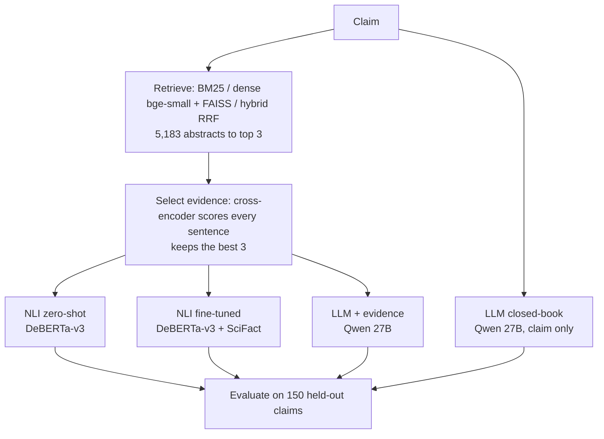

# Evidence-Grounded Claim Verification: Retrieval + NLI vs. LLM

A retrieve-then-verify fact-checking pipeline for scientific claims, benchmarked on [SciFact](https://github.com/allenai/scifact). Given a claim, it searches 5,183 research abstracts, selects the most relevant evidence sentences, and decides whether they **SUPPORT** the claim, **CONTRADICT** it, or give **NOT ENOUGH INFO (NEI)**, citing the sentence behind each verdict.

The project compares four verifiers on identical evidence: a zero-shot NLI model, the same model fine-tuned on SciFact, an LLM given the evidence, and the same LLM with no evidence at all.

**Highlights**

- Fine-tuning a 184M-parameter DeBERTa-v3 NLI model raised macro-F1 from **0.53 to 0.70** (± 0.015 over 3 seeds), with confidence intervals overlapping a **27B-parameter LLM** given the same evidence (0.76). It is **34× faster per claim** (32 ms vs 1,097 ms) and needs no API.
- Without retrieved evidence, the LLM fell to **0.41** macro-F1 and gave a verdict on **59 of 63** claims that have no supporting evidence. With evidence, that dropped to 12.
- Dense retrieval (bge-small + FAISS) reached **Recall@3 of 0.86** over 5,183 abstracts.


## Pipeline



The three evidence-based verifiers read exactly the same three sentences, so score differences come from the verifier alone. The closed-book condition removes retrieval to measure what it contributes.

## Results

Scored on 150 held-out claims (a random sample of the SciFact dev set: 60 SUPPORT, 27 CONTRADICT, 63 NEI).

| System | Macro-F1 | 95% CI | Accuracy | Strict acc. | Ungrounded verdicts | Latency (ms/claim) |
|---|---|---|---|---|---|---|
| Majority class | 0.190 | 0.164–0.214 | 40.0% | – | – | – |
| NLI zero-shot | 0.534 | 0.446–0.610 | 55.3% | 50.0% | 51.6% | 9 |
| NLI fine-tuned | 0.684 | 0.605–0.760 | 70.7% | 64.7% | 33.3% | 32 |
| LLM + evidence | **0.756** | 0.676–0.830 | **76.7%** | **70.7%** | **25.9%** | 1,097 |
| LLM closed-book | 0.412 | 0.344–0.474 | 45.3% | – | – | 1,020 |

The fine-tuned row shows the seed-42 run; across 3 seeds its macro-F1 was **0.704 ± 0.015**. Confidence intervals come from 1,000 bootstrap resamples. Strict accuracy and ungrounded verdicts don't apply to systems that cite no evidence.

**Per-label F1**

| System | SUPPORT | CONTRADICT | NEI |
|---|---|---|---|
| NLI zero-shot | 0.500 | 0.493 | 0.609 |
| NLI fine-tuned | 0.789 | 0.566 | 0.696 |
| LLM + evidence | 0.793 | 0.702 | 0.773 |
| LLM closed-book | 0.656 | 0.479 | 0.101 |

### Key findings

1. **Fine-tuning fixes domain shift.** The zero-shot model, trained on general-domain NLI, labelled most scientific paraphrases "neutral": it got only 20 of 60 SUPPORT claims right. After fine-tuning it got 43, and SUPPORT F1 rose from 0.50 to 0.79.
2. **A small model comes close to a large one.** The fine-tuned model (0.70 mean) and the evidence-grounded LLM (0.76) have overlapping 95% intervals, so 150 claims cannot separate them. The NLI model runs locally in 32 ms per claim; the LLM takes about 1.1 s through an API.
3. **Evidence curbs hallucination.** Closed-book, the LLM committed to a verdict on 59 of 63 no-evidence claims (NEI F1 0.10). Given evidence and told to use only that, it dropped to 12.
4. **Fine-tuning also improves grounding.** Ungrounded verdicts fell from 51.6% to 33.3%, and strict accuracy rose from 50.0% to 64.7%.
5. **The systems fail differently.** The fine-tuned model's most common error is caution (13 missed verdicts where the evidence was present). The LLM's is committing on claims with no evidence (12).

### Retrieval

| Retriever | Recall@1 | Recall@3 | Recall@5 | Recall@10 |
|---|---|---|---|---|
| BM25 | 0.712 | 0.832 | 0.865 | 0.936 |
| Dense (bge-small + FAISS) | 0.744 | 0.859 | 0.898 | 0.957 |
| Hybrid (RRF) | 0.741 | 0.867 | 0.917 | 0.953 |

Test set, all 300 dev claims. The retriever was chosen on the validation split, where dense retrieval led clearly (Recall@3 0.911 vs 0.859 hybrid and 0.722 BM25). Hybrid edges ahead on test, but choosing on test would leak information. A gold abstract appears in the top 3 for 87.2% of test claims, and a gold sentence survives evidence selection for 72.3%, which caps strict accuracy for every verifier.

### Error analysis

Each wrong answer is attributed to the first stage that failed:

| Error type | NLI zero-shot | NLI fine-tuned | LLM + evidence |
|---|---|---|---|
| Retrieval miss | 8 | 7 | 7 |
| Sentence-selection miss | 10 | 7 | 5 |
| Missed verdict (said NEI) | 25 | 13 | 6 |
| Flipped label | 7 | 2 | 5 |
| Verdict on NEI claim | 17 | 15 | 12 |


## Method

**Data.** SciFact: 1,409 expert-written claims verified against 5,183 biomedical abstracts, with sentence-level evidence ("rationales"). The official test labels are hidden, so the 300-claim dev set serves as the test set. 100 of the 809 training claims are held out (stratified by label) as a validation split for every tuning decision. No claims had conflicting labels. The final comparison uses a fixed random 150 of the 300 test claims because of LLM API limits.

**Retrieval.** BM25 (`rank_bm25`, stop words removed); dense retrieval with `BAAI/bge-small-en-v1.5` and an exact FAISS inner-product index over normalised embeddings; hybrid via Reciprocal Rank Fusion (k = 60).

**Evidence selection.** `cross-encoder/ms-marco-MiniLM-L-6-v2` scores every sentence of the top 3 abstracts; the top 3 sentences become the evidence.

**NLI verifier.** `MoritzLaurer/DeBERTa-v3-base-mnli-fever-anli`, with each evidence sentence as the premise and the claim as the hypothesis. The verdict is the strongest entailment or contradiction score across sentences, and NEI below a threshold τ tuned for macro-F1 on validation (0.90 zero-shot; 0.45–0.75 across fine-tuning seeds). The sentence that produced the verdict is the citation.

**Fine-tuning.** 954 positive pairs (gold rationales, joined and as single sentences) plus 1,431 hard negatives: retrieved sentences that are not rationales, labelled neutral. 2 epochs, AdamW (lr 2e-5, weight decay 0.01), batch 16, linear warmup and decay, fp16 mixed precision with fp32 master weights. Training loss fell from about 0.68 to 0.33; each run took 82 s on a T4 GPU. Three seeds (42, 43, 44).

**LLM verifier.** `qwen/qwen3.8-27b` via Groq's OpenAI-compatible API, at temperature 0 with reasoning disabled. It returns JSON with a label, cited sentence numbers and a reason. The evidence prompt restricts it to the three given sentences; the closed-book prompt gives only the claim. Responses are cached, and rate limits are handled with retries.

**Metrics.**
- *Macro-F1:* averages per-label F1, so the minority CONTRADICT class counts equally.
- *Strict accuracy:* requires the right label and, for SUPPORT/CONTRADICT, at least one cited gold sentence.
- *Ungrounded verdicts:* the share of SUPPORT/CONTRADICT answers whose cited sentence is not gold.
- *Latency:* the verifier step only.

## Repository structure

```
├── claim_verification.ipynb   # full pipeline, with outputs
├── README.md
├── requirements.txt
└── results/
    ├── main_results.csv        # results table
    ├── failures.csv            # every wrong answer with its evidence
    ├── llm_cache.json          # cached LLM responses
    ├── macro_f1.png
    ├── confusion_matrices.png
    ├── error_breakdown.png
    ├── label_distribution.png
    └── demo.png
```

## Running it

1. Open `claim_verification.ipynb` in Google Colab and select a **T4 GPU** runtime.
2. Add a free API key from [Groq](https://console.groq.com) (or any OpenAI-compatible provider) as a Colab secret named `LLM_API_KEY`.
3. Run all cells. Everything except the LLM section takes a few minutes on a T4; the LLM section depends on the provider's rate limits.

To skip the LLM entirely, set `RUN_LLM = False` in section 6. The final section launches a Gradio demo that verifies any typed claim.

## Limitations

- 150 test claims give wide confidence intervals; the LLM and fine-tuned NLI results are not statistically separable.
- One LLM and one prompt were tested.
- The NLI verifier judges one sentence at a time, so evidence split across sentences can be missed.
- Grounding is measured against expert-marked sentences, which do not cover every valid piece of evidence, so the ungrounded rate is an upper bound.
- The LLM may have seen SciFact or its source papers during pretraining.
- LLM latency includes network time to the API.

## Next steps

- Evaluate on all 300 dev claims.
- Let the verifier combine evidence across sentences.
- Try a biomedical embedding model, or fine-tune the retriever on SciFact.
- Build a cascade: the NLI model first, and the LLM only for low-confidence claims.
- Test transfer to news claims.

## Data, models and citation

- **SciFact** (CC BY-NC 2.0): Wadden et al., *Fact or Fiction: Verifying Scientific Claims*, EMNLP 2020.
- **Models:** [bge-small-en-v1.5](https://huggingface.co/BAAI/bge-small-en-v1.5), [ms-marco-MiniLM-L-6-v2](https://huggingface.co/cross-encoder/ms-marco-MiniLM-L-6-v2), [DeBERTa-v3-base-mnli-fever-anli](https://huggingface.co/MoritzLaurer/DeBERTa-v3-base-mnli-fever-anli), and Qwen via [Groq](https://groq.com).

```bibtex
@inproceedings{wadden2020fact,
  title     = {Fact or Fiction: Verifying Scientific Claims},
  author    = {Wadden, David and Lin, Shanchuan and Lo, Kyle and Wang, Lucy Lu and van Zuylen, Madeleine and Cohan, Arman and Hajishirzi, Hannaneh},
  booktitle = {Proceedings of the 2020 Conference on Empirical Methods in Natural Language Processing (EMNLP)},
  year      = {2020}
}
```

